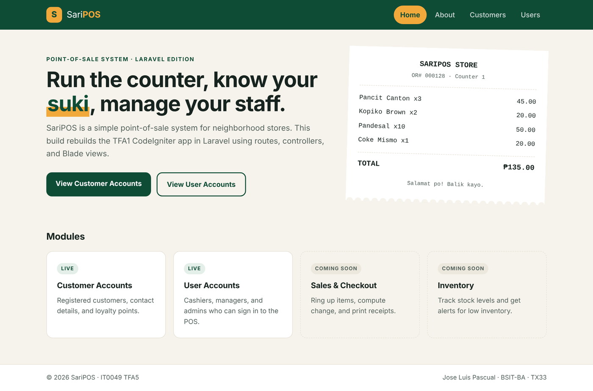
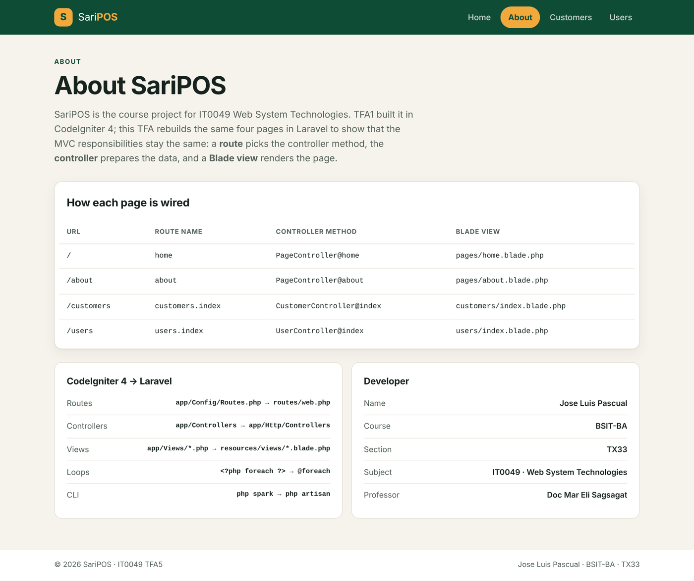
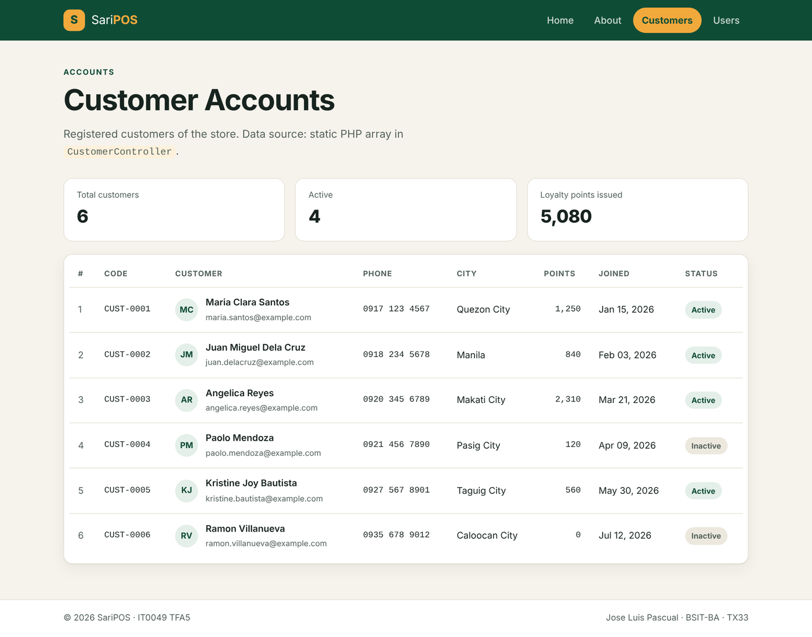
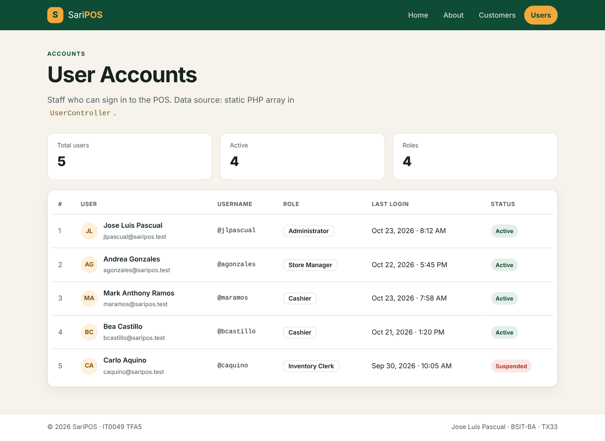
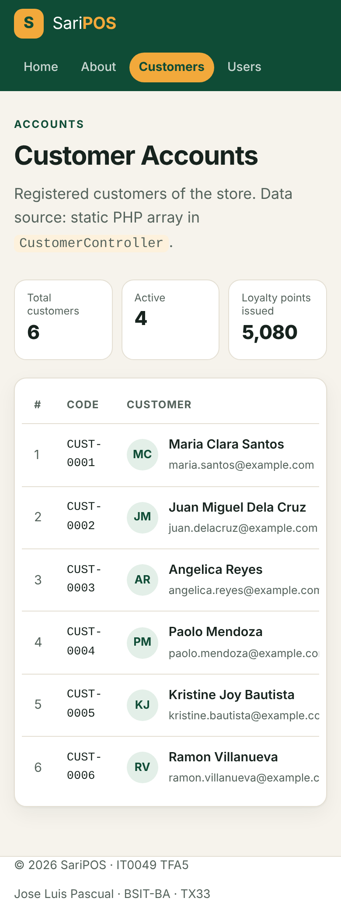

# SariPOS — Laravel POS Foundations (IT0049 TFA5)

**From Zero to Four Pages, Again: Your First Laravel Application**

SariPOS is a simple point-of-sale system for neighborhood stores. This TFA rebuilds the
TFA1 CodeIgniter 4 app in **Laravel**: a landing page, an about page, a Customer Accounts
page and a User Accounts page. The two account pages read from **static PHP arrays**
defined in their controllers and loop through them with Blade's `@foreach`.

| | |
|---|---|
| **Student** | Jose Luis Pascual |
| **Course / Section** | BSIT-BA / TX33 |
| **Subject** | IT0049 — Web System Technologies |
| **Professor** | Doc Mar Eli Sagsagat |
| **Live site** | https://YOUR-SUBDOMAIN.infinityfreeapp.com |
| **Repository** | https://github.com/YOUR-USERNAME/IT0049-TFA5-Laravel-POS |

---

## Pages and routes

| URL | Route name | Controller method | Blade view |
|---|---|---|---|
| `/` | `home` | `PageController@home` | `resources/views/pages/home.blade.php` |
| `/about` | `about` | `PageController@about` | `resources/views/pages/about.blade.php` |
| `/customers` | `customers.index` | `CustomerController@index` | `resources/views/customers/index.blade.php` |
| `/users` | `users.index` | `UserController@index` | `resources/views/users/index.blade.php` |

All routes are defined in `routes/web.php`. Every page shares one layout
(`resources/views/layouts/app.blade.php`) with a navigation bar linking all four pages.

## Screenshots

**Landing page — `/`**



**About page — `/about`**



**Customer Accounts — `/customers`** (static array of 6 records, looped with `@foreach`)



**User Accounts — `/users`** (static array of 5 records, looped with `@foreach`)



**Mobile view — `/customers`**



Screenshots are stored in `docs/screenshots/`.

## Project structure (files written for this TFA)

```
app/
├── Http/Controllers/
│   ├── PageController.php        # home() and about()
│   ├── CustomerController.php    # static array of 6 customer records
│   └── UserController.php        # static array of 5 user records
├── Models/
│   ├── Customer.php              # for the customers table (used by the seeder)
│   └── User.php                  # Laravel's User model + POS fields
└── Providers/AppServiceProvider.php  # forces https links when APP_URL is https
database/
├── migrations/
│   ├── ..._create_customers_table.php
│   └── ..._add_pos_fields_to_users_table.php
├── seeders/
│   ├── DatabaseSeeder.php
│   ├── CustomerSeeder.php
│   └── UserSeeder.php
└── saripos_db.sql                # MySQL export (tables + sample data)
public/css/app.css                # stylesheet (plain CSS, no npm build needed)
resources/views/
├── layouts/app.blade.php
├── partials/nav.blade.php, partials/footer.blade.php
├── pages/home.blade.php, pages/about.blade.php
├── customers/index.blade.php
└── users/index.blade.php
routes/web.php
docs/screenshots/                 # screenshots of the four pages
.htaccess                         # sends requests to public/ on shared hosting
```

## Static array data source

Each account controller keeps its records in a private array property, with the same
keys on every record:

```php
// app/Http/Controllers/CustomerController.php
private array $customers = [
    ['id' => 1, 'customer_code' => 'CUST-0001', 'name' => 'Maria Clara Santos', ...],
    ...
];

public function index(): View
{
    return view('customers.index', ['customers' => $this->customers, ...]);
}
```

The view loops through it:

```blade
@foreach ($customers as $customer)
    <tr>
        <td>{{ $customer['customer_code'] }}</td>
        <td>{{ $customer['name'] }}</td>
        ...
    </tr>
@endforeach
```

The migrations and seeders create matching `customers` and `users` tables so a later TFA can
swap the arrays for database queries without changing the views.

---

## Requirements

- PHP **8.2 or newer** (XAMPP's PHP 8.2 works)
- [Composer](https://getcomposer.org/download/)
- MySQL/MariaDB (XAMPP) — only needed for the migrations/seeders; the pages run without it

## Setup and run locally

```bash
git clone https://github.com/YOUR-USERNAME/IT0049-TFA5-Laravel-POS.git
cd IT0049-TFA5-Laravel-POS

composer install
cp .env.example .env          # Windows CMD: copy .env.example .env
php artisan key:generate

php artisan serve
```

Open http://127.0.0.1:8000 and use the navigation bar to visit all four pages.

### Optional: create the database

1. Start MySQL in XAMPP and create a database named `saripos_db` in phpMyAdmin.
2. Check the `DB_*` values in `.env` (defaults: `root`, no password).
3. Run:

```bash
php artisan migrate --seed
```

Or import `database/saripos_db.sql` in phpMyAdmin instead.

### Useful Artisan commands used in this activity

```bash
php artisan route:list --except-vendor     # show the four routes
php artisan make:controller PageController
php artisan make:controller CustomerController
php artisan make:controller UserController
php artisan make:model Customer
php artisan make:migration create_customers_table
php artisan make:seeder CustomerSeeder
```

## Deployment (InfinityFree)

InfinityFree's web root is fixed to `htdocs/`, so the whole project is uploaded there and the
root `.htaccess` passes every request to `public/`. Requests for `.env`, `composer.json` or any
source file never reach those files directly.

Short version:

1. `composer install --no-dev` and `php artisan optimize:clear` locally.
2. Make a production `.env`: `APP_ENV=production`, `APP_DEBUG=false`, `APP_URL=https://your-site`.
3. Upload everything (including `vendor/`, `.env` and `.htaccess`) into `htdocs/` with FileZilla.
4. Optionally import `database/saripos_db.sql` with InfinityFree's phpMyAdmin.

See `DEPLOYMENT.md` for the full step-by-step guide.

## References

- Laravel Documentation — Routing: https://laravel.com/docs/routing
- Laravel Documentation — Blade Templates: https://laravel.com/docs/blade
- Stauffer, M. (2024). *Laravel: Up & Running* (3rd ed.)
